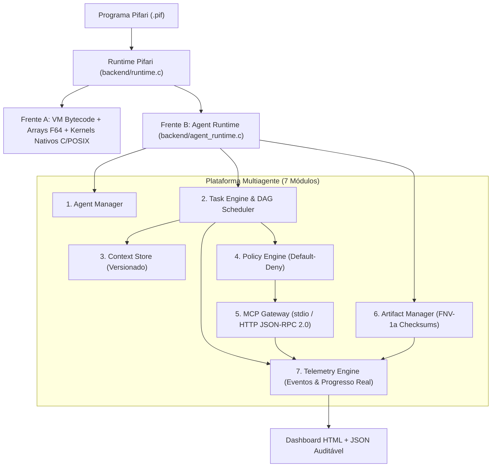

# Arquitetura do Agent Runtime e MCP Gateway no Pifari

**Data:** 2026-10-23  
**Projeto:** `Pifari_Definicao/frontend_flex_bison`  
**Módulos C:** `backend/agent_runtime.h`, `backend/agent_runtime.c`, `backend/mcp_gateway.h`, `backend/mcp_gateway.c`

---

## 1. Visão Geral e Separação Arquitetural

O Pifari evoluiu em duas frentes integradas, porém desacopladas arquiteturalmente:

1. **Frente A — Compilador, VM numérica e Kernels Nativos (`frontend/`, `backend/runtime.c`, `backend/ast_ir.c`, `backend/optimizer.c`, `backend/native_kernel.c`):**
   - Responsável pela avaliação de expressões, bytecode de funções, arrays contíguos (`f64_array` com indexação direta `A[i] = val`), operadores de fluxo (`|>`, `>|`, `|<`, `<|`), JIT inteiro e kernels C fundidos com cache persistente de `.so` por hash FNV-1a 64-bit.
2. **Frente B — Plataforma de Orquestração Multiagente e MCP (`backend/agent_runtime.c` e `backend/mcp_gateway.c`):**
   - Totalmente independente da gramática Flex/Bison (`frontend/parser.y` permanece em `%expect 7` com zero novos conflitos).
   - Desacopla o **protocolo de coordenação de ferramentas/recursos (MCP JSON-RPC 2.0)** do **adaptador de modelo/agente (`model_adapter`)**, evitando acoplamento do compilador a qualquer provedor específico de IA.

---

## 2. Os 7 Módulos Obrigatórios

### 2.1. Task Engine (`ArTaskEntry` / `agent_runtime_dag_run`)
- Representa cada tarefa com `task_id`, `agent_id`, `server_id`, `tool_name`, `args_json`, `output_ctx_key`, `priority`, `timeout_ms`, lista de dependências (`deps[8]`), `state` (`PENDING`, `READY`, `RUNNING`, `COMPLETED`, `FAILED`, `CANCELLED`) e `version` (iniciado em `1`, incrementado a cada transição de estado).
- **Grafo de Tarefas (DAG) Paralelo:**
  - Tarefas sem dependências pendentes transitam para `READY` e são despachadas em paralelo via `pthread_create` respeitando o limite global (`max_parallel`), o limite por agente (`max_concurrency`) e a prioridade (`priority`).
  - Tarefas dependentes aguardam a conclusão (`COMPLETED`) de todos os pré-requisitos; caso uma dependência falhe ou seja cancelada, as tarefas dependentes são automaticamente transicionadas para `CANCELLED` com registro na telemetria.
- **Cancelamento e Deadlines:**
  - Suporta cancelamento explícito (`task_cancel(task_id, motivo)`) antes ou durante a execução, e cancelamento automático por estouro de deadline (`timeout_ms`).

### 2.2. Agent Manager (`ArAgentEntry`)
- Gerencia o ciclo de vida dos agentes registrados via `Agent(id, role, goal, adapter, max_concurrency, timeout_ms)`.
- Mantém contadores atômicos/protegidos por mutex (`active_tasks`, `completed_tasks`, `failed_tasks`, `cancelled_tasks`), `version`, último resultado estruturado (`last_result`), último erro (`last_error`) e desacopla o papel do agente do `model_adapter` (`"local-deterministic"`, `"mcp-worker"`, ou adaptadores externos).

### 2.3. MCP Gateway (`backend/mcp_gateway.h` / `backend/mcp_gateway.c`)
- Implementa o protocolo **Model Context Protocol (`2025-03-26`)** sobre JSON-RPC 2.0 nos transportes:
  - **`stdio`**: processo filho POSIX via `pipe()`, `fork()`, `dup2()`, `execl()`, leitura não-bloqueante com `poll()` a cada 15 ms para verificação de `timeout_ms` e `cancel_flag`, envio de `notifications/cancelled` em caso de cancelamento/timeout, descarte seguro de respostas órfãs por correlação de `id` JSON-RPC e encerramento limpo (`SIGTERM` → `waitpid` → `SIGKILL`).
  - **`http`**: socket TCP POSIX não-bloqueante com `poll()`, cabeçalhos `Content-Type: application/json`, `Accept: application/json, text/event-stream`, suporte a sessão `Mcp-Session-Id` e leitura de token de autenticação via variável de ambiente (`getenv(auth_env_var)`) **sem jamais armazenar ou registrar o segredo em memória persistente ou logs**.
- Suporta `initialize` + `notifications/initialized`, `tools/list`, `tools/call`, `resources/list` e `resources/read`.
- **Proteção de Idempotência vs. Efeitos Colaterais:** Ferramentas marcadas com `readOnlyHint: false` / `sideEffect: true` (ou prefixos mutáveis `write_`, `mutate_`, `delete_`) possuem guarda de hash FNV-1a contra chamadas duplicadas (`MCP_STATUS_ERR_DUPLICATE_CALL`) e nunca sofrem retry automático.

### 2.4. Context Store (`ArContextItem`)
- Armazenamento chave-valor compartilhado e thread-safe (`pthread_mutex_t`) com controle de versão (`version` iniciando em `1`, preservado em no-ops quando o valor não muda) e proveniência (`producer_agent_id`, `producer_task_id`, `updated_at_ms`).
- Suporta interpolação segura de templates `{{ctx:chave}}` nos argumentos JSON das tarefas dependentes, escapando caracteres especiais JSON antes de invocar o MCP Gateway.

### 2.5. Policy Engine (`ArPolicyRule`)
- Modelo **Default-Deny**: nenhuma ferramenta MCP pode ser invocada por um agente sem uma regra explícita registrada via `policy_allow(agent_id, server_id, tool_name, allow_side_effects)`.
- Distingue permissão de leitura (`allow_side_effects = false`) de permissão de mutação (`allow_side_effects = true`). Mesmo que uma ferramenta esteja listada para o agente, se ela tiver efeito colateral e `allow_side_effects` for `false`, o Policy Engine bloqueia a execução e registra `POLICY_DENY` na telemetria.

### 2.6. Telemetry Engine (`ArTelemetryEvent`)
- Registra eventos estruturados em ordem monotônica (`seq`, `timestamp_ms`, `event_type`, `agent_id`, `task_id`, `server_id`, `tool_name`, `status`, `duration_ms`, `detail`).
- Calcula o progresso percentual real do DAG: `(completed + failed + cancelled) * 100 / total_tasks`.
- Exporta o relatório completo em JSON (`telemetry_export(path)`) consumido pelo painel `dashboard/index.html`.

### 2.7. Artifact Manager (`ArArtifactEntry`)
- Persiste arquivos produzidos pelos agentes (`artifact_save(artifact_id, file_path, content, agent_id, task_id)`), calcula o checksum **FNV-1a 64-bit** (`checksum_fnv1a`) e registra tamanho em bytes, timestamp e proveniência (`producer_agent_id`, `producer_task_id`).
